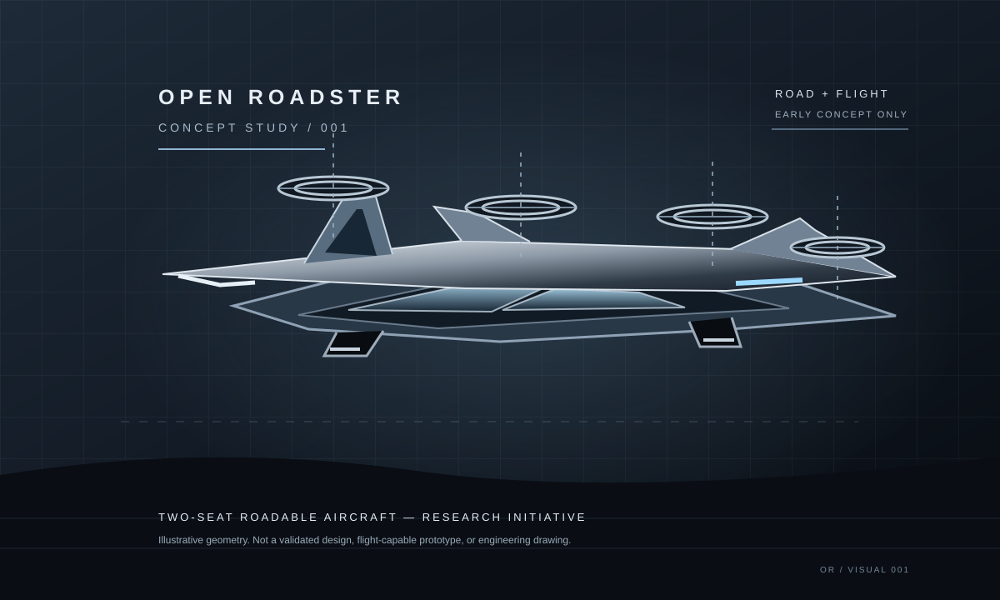

# OPEN ROADSTER

**An open engineering initiative exploring a two-seat roadable aircraft.**

> **CONCEPT STAGE:** This image is an original illustration, not an engineering drawing. No operational aircraft, validated flight performance, roadworthiness, or certification is claimed.

## Mission
Investigate the engineering, regulatory, and safety challenges of a vehicle intended to operate both on public roads and in flight. Develop the project in public and publish assumptions, decisions, and evidence.

## Start here
- [Project brief](docs/PROJECT_BRIEF.md)
- [Initial requirements](docs/REQUIREMENTS.md)
- [Architecture study](docs/ARCHITECTURE_STUDY.md)
- [Contributing](CONTRIBUTING.md)
- [Governance](community/GOVERNANCE.md)
- [Safety policy](safety/SAFETY_POLICY.md)
- [Launch plan](community/LAUNCH_PLAN.md)
- [Contributor recruitment post](community/RECRUITMENT_POST.md)
- [Landing page](website/index.html)
- [Interim privacy notice](website/privacy.html)

## Principles
1. Evidence before claims.
2. Concept visuals are not engineering evidence.
3. Safety-critical changes require qualified review.
4. Publish assumptions, uncertainty, rejected alternatives, and test results.
5. Simulation does not equal physical validation.

## Licensing
Licensing is under review. No blanket license is claimed for all future assets. Select and document suitable licenses for hardware, software, documentation, and third-party assets before accepting reusable contributions. [Track the licensing decision](https://github.com/akameredon/open-roadster/issues).

## Participate
Open an issue to propose research or ask a question. Do not build, modify, or fly an aircraft based only on concept material in this repository.